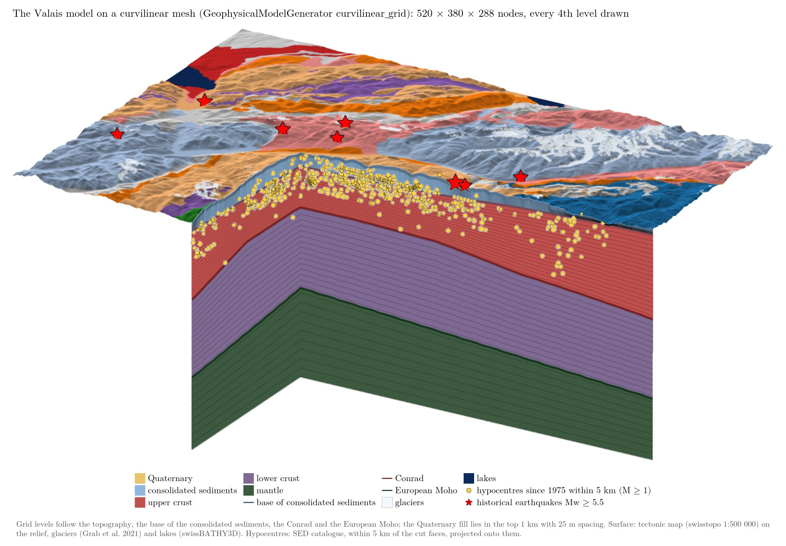

# GeoValaisWallis3D.jl

3D geological and geophysical model of the Valais/Wallis region (Switzerland).
The geomodel is constructed from the topographic surface down to below the Moho, built with
[GeophysicalModelGenerator.jl](https://github.com/JuliaGeodynamics/GeophysicalModelGenerator.jl), which allows to bring together data coming from different sources.
In addition, it also handles different 3D mesh gemoetries (rectilinear and curvilinear), which can then be employed for subsequent computations.  

## Data sources

| Component | Dataset | Source / licence |
|---|---|---|
| Topography | swissALTIRegio (10 m DEM) — Valais window read over HTTP | swisstopo, [data.geo.admin.ch](https://data.geo.admin.ch/browser/index.html#/collections/ch.swisstopo.swissaltiregio), OGD |
| Quaternary deposits | swissBEDROCK3D (release 15 Oct 2026): bedrock elevation, thickness of unconsolidated deposits (10 m) | swisstopo, [swissBEDROCK](https://www.swisstopo.admin.ch/en/3d-swissbedrock-en), OGD |
| Surface geology | Tectonic Map of Switzerland 1:500 000 | swisstopo, `ch.swisstopo.geologie-tektonische_karte`, OGD |
| Crustal layers, density | 3D-ALPS (20 km grid): sediments, upper/lower crust, lithospheric mantle | Spooner et al. (2019), [doi:10.5880/GFZ.4.5.2019.004](https://doi.org/10.5880/GFZ.4.5.2019.004), CC BY 4.0 |
| Temperature | 3D-ALPS-TR steady-state thermal model | Spooner et al. (2020), [doi:10.5880/GFZ.4.5.2020.007](https://doi.org/10.5880/GFZ.4.5.2020.007), CC BY 4.0 |
| Moho | European and Adriatic Moho (5 km grid) | Spada et al. (2013, GJI) |
| Local 3D geology | Nappe de Morcles (18 formations, 50 m voxels) | Thornton et al. (2018), [doi:10.6084/m9.figshare.c.4130759](https://doi.org/10.6084/m9.figshare.c.4130759), CC0 |
| Gravity | Gravimetric Atlas of Switzerland 1:100 000 (points, complete Bouguer anomaly, 2670 kg/m³); Gravimetric Map 1:500 000 (Bouguer contours); National Gravity Network LSN2004 (absolute *g*) | swisstopo, map.geo.admin.ch layers `ch.swisstopo.geologie-gravimetrischer_atlas.messpunkte`, `ch.swisstopo.geologie-geodaesie-bouguer_anomalien`, `ch.swisstopo.landesschwerenetz`, OGD |
| Glaciers | Swiss Glacier Thickness – Release 2020: glacier bed elevation of the Swiss Glacier Inventory glaciers (10 m) | Grab et al. (2021), ETH Zurich, [doi:10.3929/ethz-b-000434697](https://doi.org/10.3929/ethz-b-000434697), CC BY 4.0 |
| Seismicity | SED earthquake catalogue: instrumental since 1975 and historical events (ECOS-09), FDSN event service `eida.ethz.ch` | Swiss Seismological Service (SED), ETH Zurich |
| Focal mechanisms | St-Léonard and Anzère sequences: 28 first-motion focal mechanisms, 734 double-difference relocations | Truttmann et al. (2023), [doi:10.5281/zenodo.7855039](https://doi.org/10.5281/zenodo.7855039), CC BY 4.0 |
| Lakes | swissBATHY3D: lake-floor elevation (Lac Léman, Lake Thun in the region) | swisstopo, [data.geo.admin.ch](https://data.geo.admin.ch/browser/index.html#/collections/ch.swisstopo.swissbathy3d), OGD |
| Seismic subsoil classes | SIA 261 classes A–F, national map incl. the Valais 1:25 000 maps of the Rhône valley (CREALP for the canton, [vs.ch](https://www.vs.ch/web/sdm/cartes-de-sol-de-fondation)); spectral microzonation perimeters | BAFU, `ch.bafu.gefahren-baugrundklassen` (release 4 Mar 2026), `ch.bafu.gefahren-spektral`, OGD |

The swisstopo **swissAlps3D (SA3D)** model is not yet publicly downloadable (2026); it can be added 
when released. Data are downloaded on first use to `data/raw/` (or `$GEOVALAIS_DATADIR/raw` if set, e.g. on a cluster scratch file system; first run ≈ 5 GB transferred,
mostly swissBEDROCK tiles; the cache is small); outputs go to `data/output/`. Both are git-ignored, no data files are stored in the GeoValaisWallis3D.jl repository.

## Repository layout

The model is built on two grids (curvilinear and rectilinear). Each grid has its own folder under `figures/`, with its README, figure script and
images:

```
src/                     the package (data access, interfaces, material rules, gravity); src/curvilinear.jl: the curvilinear mesh
examples/rectilinear/    build the rectilinear model and write ParaView files
examples/curvilinear/    build the curvilinear model and write ParaView files
examples/                gravity_maps.jl, subsoil_classes.jl: data sets that do not depend on the grid
figures/                 Julia environment of the figure scripts (CairoMakie, GLMakie, Metal)
figures/rectilinear/     model on a rectilinear grid: README, make_figures.jl, images
figures/curvilinear/     model on a curvilinear (terrain-following) mesh of GMG: README, make_figures.jl, images
test/                    tests
```

| | [rectilinear grid](figures/rectilinear/README.md) | [curvilinear mesh](figures/curvilinear/README.md) |
|---|---|---|
| builder | `build_valais_model`, `valais_model_maps` | `build_valais_curvilinear_model`, `valais_curvilinear_maps` |
| levels | horizontal; 25 m in the elevation band of the Quaternary fill | follow the topography, base of consolidated sediments, Conrad, European Moho |
| topography | staircase of cells, air cells above it (NaN) | the top grid level; no air nodes |
| gravity inversion | `invert_density(xg, yg, zg, …)`, rock fractions at the surface | `invert_density(Grid, …)` on `curvilinear_density_model` |

Both grids share the data, the interfaces (`model_interfaces`) and the material rules, so the same column gives the
same phases on both. The pictures below show the data sets, made with the rectilinear grid; the same analysis on the
curvilinear mesh, with its figures, is in [figures/curvilinear/](figures/curvilinear/README.md).



## The data sets in pictures

All figures are made from the cached data by `figures/rectilinear/make_figures.jl` (see [figures/rectilinear/README.md](figures/rectilinear/README.md#figures)).

**Overview.** Shaded relief of swissALTIRegio with the tectonic units of the 1:500 000 map, which are written into the
surface dataset. The box marks the Nappe de Morcles 3D model, and the dashed lines the cross-sections A–A' and B–B'
further down.


**Seismic subsoil classes: mapping the surface.** In the Rhône valley, the BAFU map of SIA 261 subsoil classes
contains the 1:25 000 maps of CREALP for the canton of Valais. Draped on the 50 m topography, they give a map of the
ground at the surface:
- rock (A);
- thin soft layers on rock on the slopes (E);
- the deep, soft fill of the valley floor (C, D).

The black outlines are the spectral microzonation studies (Sion, Martigny, Brig-Visp, Chablais); inside them the class
map has gaps. The classes are indicative: they don't replace a site study. On the valley floor they mirror the thick
Quaternary of swissBEDROCK (next figure), which sets phase 1 of the model.


**Interfaces of the model.** Each interface comes from one dataset:
- the topography (swissALTIRegio);
- the Quaternary thickness (swissBEDROCK, up to ≈ 600 m under Lake Geneva and the Rhône valley);
- the base of the consolidated sediments and the upper/lower crust boundary (3D-ALPS, scaled to the Spada Moho);
- the European and Adriatic Moho (Spada et al. 2013).

The Adriatic Moho exists only in the south-east corner (Ivrea).


**Cross-sections through the 3D model** (`valais_model_block`, 250 m grid) along A–A' (N–S through Sion) and B–B'
(W–E along the Rhône valley). The rows show:
- the phases;
- Vs from the first-order velocity laws (`DEFAULT_VELOCITIES`, to be calibrated);
- the 3D-ALPS-TR temperature;
- the shallow part, with the Quaternary fill of the valley and the Morcles basement.

The steps in the deep interfaces come from the 20 km grid of 3D-ALPS.


**Gravity.** The complete Bouguer anomaly is shown from the 1:100 000 atlas points and from the 1:500 000 contours. The
attraction of the topography is computed by this package, and the free-air anomaly is their sum. The triangles are the
LSN2004 stations, where the free-air anomaly is known exactly (see [Gravity anomalies](#gravity-anomalies)).


**Density inversion of the Bouguer anomaly** with the new adjoint gravity code of GeophysicalModelGenerator
(`voxel_grav` + `voxel_grav_adjoint`, GMG ≥ 0.10.1) and LSQR, through `invert_density` (see
[Density inversion](#density-inversion)).
- **Starting model:** the density of the 3D model (3D-ALPS densities, 2000 kg/m³ for the Quaternary).
- **Grid:** averaged onto a 1 km grid padded by 20 km on every side.
- **Data:** fits the atlas points (σ = 2 mGal) with Li & Oldenburg depth weighting and a regional plane.
- **Stopping:** at the discrepancy principle.
- **Run:** 8168 points and ≈ 1.0 M unknowns; LSQR stops after 62 iterations (71 s on an Apple M2 Max GPU).
- **Result:** the rms misfit in the model region drops from 18.1 to 1.9 mGal. The largest change is the dense Ivrea body
  in the south-east (+200 kg/m³ and more): the starting model is too light there.

The figure shows:
- top: the observed anomaly and the residuals of the starting and inverted models;
- middle: the density change at four depths;
- bottom: the A–A' section and the convergence.


**Nappe de Morcles** (Thornton et al. 2018): the 18 formations of the 50 m voxel model, at the surface and in a W–E
section. Below the bedrock surface they replace the regional geology inside this box.


## Model

- **Coordinates**: Swiss LV95 (EPSG:2056), km (`x` easting, `y` northing, `z` elevation). The grids are described in
  [figures/rectilinear/README.md](figures/rectilinear/README.md) and [figures/curvilinear/README.md](figures/curvilinear/README.md).
- **Phases** (`PHASES`): `0` air, `1` Quaternary deposits, `2` consolidated sediments
  (Alpine sedimentary nappes), `3` upper crust, `4` lower crust, `5` mantle,
  `6` Adriatic mantle wedge (Ivrea body), `7` glacier ice, `8` lake water.
  - Ice and water (`glaciers = true`, `lakes = true`; off by default): between the topography and the glacier bed
    (Grab et al. 2021) or the lake floor (swissBATHY3D). The topography is the surface of the ice and the lakes, and
    swissBEDROCK counts the Quaternary from the glacier bed and the lake floor. Without these options the glaciers are
    rock, and under the lakes the Quaternary starts at the water surface (the bedrock is too high by the water depth).
    Ice: Vp 3.8, Vs 1.9 km/s, 917 kg/m³; water: Vp 1.48 km/s, Vs 0, 1000 kg/m³.
  - Quaternary base = solid surface − swissBEDROCK thickness (0 outside Switzerland); the solid surface is the
    topography, or the glacier bed / lake floor with `glaciers` / `lakes`.
    With `min_fill = 0.5` (default 0), deposits that fill less than half of the column's top cell are dropped.
  - Base of consolidated sediments = 3D-ALPS top of upper crust (≤ bedrock).
  - Upper/lower crust boundary at the 3D-ALPS fraction of crystalline-crust thickness, scaled to the Spada Moho.
  - Inside the Morcles model box, its formations override the geology below the bedrock surface
    (basement → upper crust, sedimentary units → consolidated sediments; field `MorclesUnit`).
- **Fields**: `Phases`, `Vp`, `Vs` (km/s), `Rho` (kg/m³; 3D-ALPS densities), `Temperature` (°C, 3D-ALPS-TR),
  `MorclesUnit`. Velocities are linear in depth below the surface per phase (`DEFAULT_VELOCITIES`,
  `LayerVelocity`) — **first-order values to be calibrated**, e.g. against Rhône valley Vs profiles.
  On the rectilinear grid, air cells (`Phases = 0`) have Vp = Vs = Rho = Temperature = NaN (`air_value` keyword; use
  `air_value = 0` for solvers that do not accept NaN); the curvilinear mesh has no air nodes.
- **Surface dataset**: topography, bedrock elevation, Quaternary thickness, tectonic units
  (3 levels), model interfaces and Moho depths. Legend of all codes in `data/output/legend.csv`.

## Usage

```bash
git clone https://github.com/tduretz/GeoValaisWallis3D.jl.git GeoValaisWallis3D   # see the note below
cd GeoValaisWallis3D
julia --project=. -e 'using Pkg; Pkg.instantiate()'
julia --project=. -t auto examples/rectilinear/build_valais_model.jl    # or examples/curvilinear/build_valais_model.jl
```

The package and module are called `GeoValaisWallis3D`; only the repository has the `.jl`. Clone it into a directory
`GeoValaisWallis3D`, as above: [ValaisRawilWaves](https://github.com/tduretz/ValaisRawilWaves) finds it there, next to its
own checkout (`path = "../GeoValaisWallis3D"`).

```julia
using GeoValaisWallis3D            # re-exports GeophysicalModelGenerator
res = build_valais_model(valais_region(); dx = 0.25, dz_fine = 0.025)       # rectilinear grid
cur = build_valais_curvilinear_model(valais_region(); dx = 0.25)            # curvilinear mesh
```

Building a model block by block, and the options of each grid: [figures/rectilinear/README.md](figures/rectilinear/README.md),
[figures/curvilinear/README.md](figures/curvilinear/README.md).

Open `data/output/*.vts` in ParaView. To hide the air: colour by e.g. `Vs`, open the Color Map Editor,
click the gear icon (advanced properties) and set **NaN Opacity** to 0 — or apply a Threshold on `Phases` ≥ 1. The `unzip` command is needed for the 3D-ALPS-TR and Morcles archives.

## Gravity anomalies

```bash
julia --project=. -t auto examples/gravity_maps.jl      # ~20 s, after a ~10 s download
```

`gravity_maps` grids the swisstopo Bouguer anomaly on the model surface (cell centres at `dx`), twice:
from the 1:100 000 atlas points (`Bouguer_mGal`, inverse-distance weighting, NaN more than 5 km from a
point) and from the 1:500 000 contour lines (`Bouguer500k_mGal`, smoother, and complete on the Italian
side). swisstopo publishes no free-air map, so the free-air anomaly is computed as **FA = BA + g_topo**.
g_topo is the attraction of the topography between sea level and the swissALTIRegio surface at
2670 kg/m³, i.e. the complete Bouguer correction. It is computed with exact prisms next to each point,
line masses at 250 m out to 10 km, and at 1 km out to 100 km, with Earth curvature. At the 177 LSN2004
stations, where the free-air anomaly is known exactly (g − γ, GRS80, LN02 heights), the map method is
off by −3.6 ± 2.6 mGal (max 10 mGal), on a free-air range of −134…206 mGal. The mean offset probably
comes from the terrain beyond 100 km (the atlas reduction goes to 167 km) and the normal-gravity
formula of the atlas.

`write_gravity_paraview` writes `data/output/valais_gravity.vts`: the surface, raised 20 m to draw
over `valais_surface.vts`, with `Bouguer_mGal`, `Bouguer500k_mGal`, `FreeAir_mGal`,
`FreeAir500k_mGal`, `TopoAttraction_mGal`. It also writes the stations as points:
`valais_gravity_atlas.vtu` and `valais_gravity_network.vtu` (exact and map free-air anomaly, misfit).

### Density inversion

GeophysicalModelGenerator ≥ 0.10.1 provides the adjoint of its gravity code (`voxel_grav_adjoint`), and
`normal_gravity` (GRS80), which this package now uses instead of its own. On top of them:

- `density_on_grid` averages a density model onto the nodes of a coarser grid. Spacing may vary, and the
  grid may be padded laterally beyond the model.
- `bouguer_contrast` turns it into the contrast a complete Bouguer anomaly sees: ρ − 2670 above sea level,
  ρ − the mean of each depth level below it.
- `invert_density` solves for the density change that explains a Bouguer anomaly at arbitrary stations,
  using LSQR (Krylov.jl) as in the GMG documentation. It uses Li & Oldenburg depth weighting, adds a
  regional plane, and stops when the misfit reaches the data error. It runs on a GPU with `backend`.
- `interpolate_nodes` maps the result back onto the model grid.

ValaisRawilWaves (`scripts/07_density_inversion.jl`) applies this to the wave-propagation model and the
atlas points.

## Seismicity

```julia
S = fetch_seismicity()             # SED catalogue in the region: time, E, N, z = -depth, depth, mag, magtype, name, type
F = fetch_focal_mechanisms()       # nodal planes, P and T axes, style (SS, NF, TF, ...): Truttmann et al. (2023)
pt_axes(53, 77, 159)               # P and T axes of a double couple; beachball(strike, dip, rake) for plotting
```

- **Catalogue:** 16 529 earthquakes in the region since 1524, 60 of M ≥ 4. The largest is the 1855 Stalden–Visp
  earthquake (Mw 6.2), followed by Aigle 1584 (Mw 5.9), Sierre 1946 (Mw 5.8, the 25 January 1946 Valais earthquake) and Ardon 1524 (Mw 5.8). Since 1975, 95 % of
  the hypocentres are shallower than 9 km (median 4 km). `eventtype = nothing` keeps quarry blasts, explosions,
  landslides and ice quakes.
- **Focal mechanisms:** the SED's event service does not deliver focal mechanisms, and its compilation is not openly
  available as a file. `fetch_focal_mechanisms` reads the published data of Truttmann et al. (2023).
  `read_focal_mechanisms(files...)` reads any file in the same SED format, e.g. a larger SED compilation.
- **In the model:** of the hypocentres since 1975 in the region, 64 % lie in the upper crust and 36 % in the consolidated
  sediments of the curvilinear model (SED depths, z = −depth). The figure is in
  [figures/curvilinear/README.md](figures/curvilinear/README.md).

## Seismic subsoil classes

```bash
julia --project=. examples/subsoil_classes.jl      # ~20 s, after an 80 MB download
```

`subsoil_map` rasterises the SIA 261 seismic subsoil classes (A–F) at 50 m on the surface grid, together
with the perimeters of the spectral microzonation studies. Inside those perimeters (Sion, Martigny,
Brig-Visp, Chablais, and in Vaud: Plaine du Rhône, Riviera), the class map has gaps, because the
microzonation replaces it; their maps and design spectra are PDFs and spreadsheets on the cantonal page.
`write_subsoil_paraview` writes `data/output/valais_subsoil.vts`: the surface raised 10 m, with
`SubsoilClass` (1–6 = A–F, NaN where not mapped), `SIA261_revision` (2003/2020) and
`SpectralMicrozonation`. The legend is in `subsoil_legend.csv`. In ParaView, colour by `SubsoilClass`
with an indexed colour map and set NaN Opacity to 0. The classes are indicative (1:25 000): they don't
replace a site study.

## Figures

```bash
julia --project=figures -e 'using Pkg; Pkg.instantiate()'
GVW_BACKEND=metal julia --project=figures -t auto figures/rectilinear/make_figures.jl   # writes figures/rectilinear/*.jpg
GVW_BACKEND=metal julia --project=figures -t auto figures/curvilinear/make_figures.jl   # writes figures/curvilinear/*.jpg
```

The `figures` environment adds CairoMakie, GLMakie and Metal to the package. The options of each script are in its
folder's README; images are converted to JPEG with ImageMagick's `magick`.

## Tests

```bash
julia --project=. -e 'using Pkg; Pkg.test()'                         # offline
GVW_ONLINE_TESTS=true julia --project=. -e 'using Pkg; Pkg.test()'   # with downloads
```

## References

- Spada, M., Bianchi, I., Kissling, E., Piana Agostinetti, N., Wiemer, S. (2013). *GJI* 194, 1050–1068.
- Spooner, C., Scheck-Wenderoth, M., Götze, H.-J., Ebbing, J., Hetényi, G. (2019). 3D-ALPS. GFZ Data Services.
- Spooner, C., Scheck-Wenderoth, M., Cacace, M., Anikiev, D. (2020). 3D-ALPS-TR. GFZ Data Services.
- Thornton, J. M., Mariethoz, G., Brunner, P. (2018). A 3D geological model of a structurally complex Alpine region as a basis for interdisciplinary research. *Sci. Data* 5, 180238.
- Wagner, M., Kissling, E., Husen, S. (2012). *GJI* 191, 789–802.
- Grab, M., Mattea, E., Bauder, A., Huss, M., Rabenstein, L., Hodel, E., Linsbauer, A., Langhammer, L., Schmid, L.,
  Church, G., Hellmann, S., Délèze, K., Schaer, P., Lathion, P., Farinotti, D., Maurer, H. (2021). Ice thickness
  distribution of all Swiss glaciers based on extended ground-penetrating radar data and glaciological modeling.
  *J. Glaciol.* 67(266), 1074–1092, doi:10.1017/jog.2021.55. Data: Swiss Glacier Thickness – Release 2020,
  doi:10.3929/ethz-b-000434697.
- Truttmann, S., Diehl, T., Herwegh, M. (2023). Hypocenter-based 3D imaging of active faults: method and applications
  in the southwestern Swiss Alps. *J. Geophys. Res. Solid Earth* 128, e2023JB026352, doi:10.1029/2023JB026352.
  Data: doi:10.5281/zenodo.7855039.
- Fäh, D., et al. (2011). ECOS-09 Earthquake Catalogue of Switzerland, Release 2011. Swiss Seismological Service, ETH Zurich.
- swisstopo: swissALTIRegio; swissBEDROCK; swissBATHY3D; Tectonic Map of Switzerland 1:500 000.
