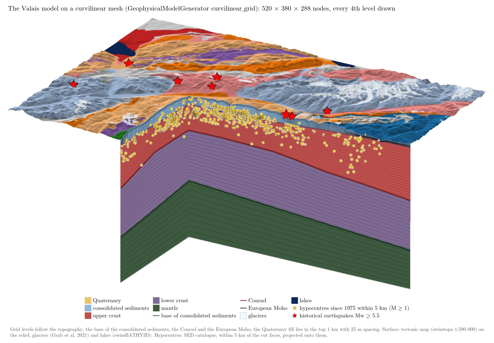
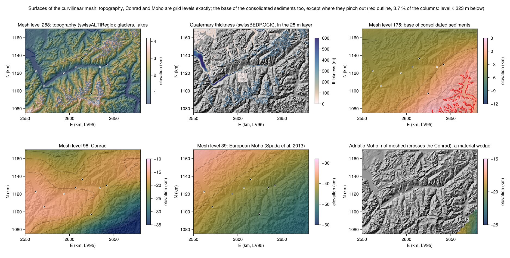
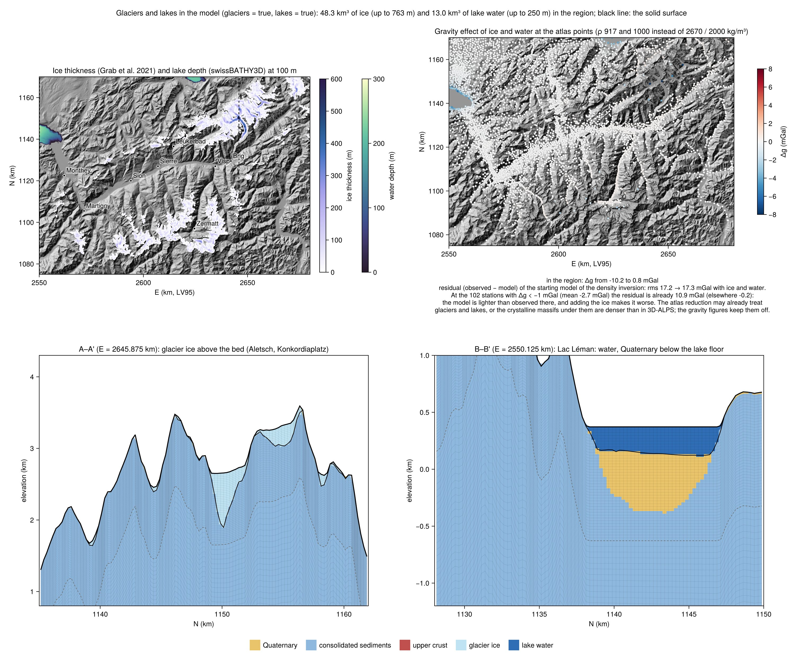
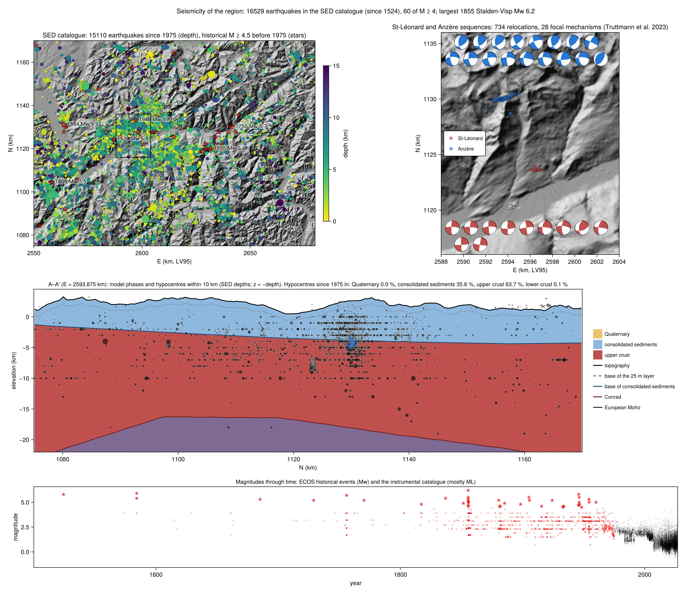
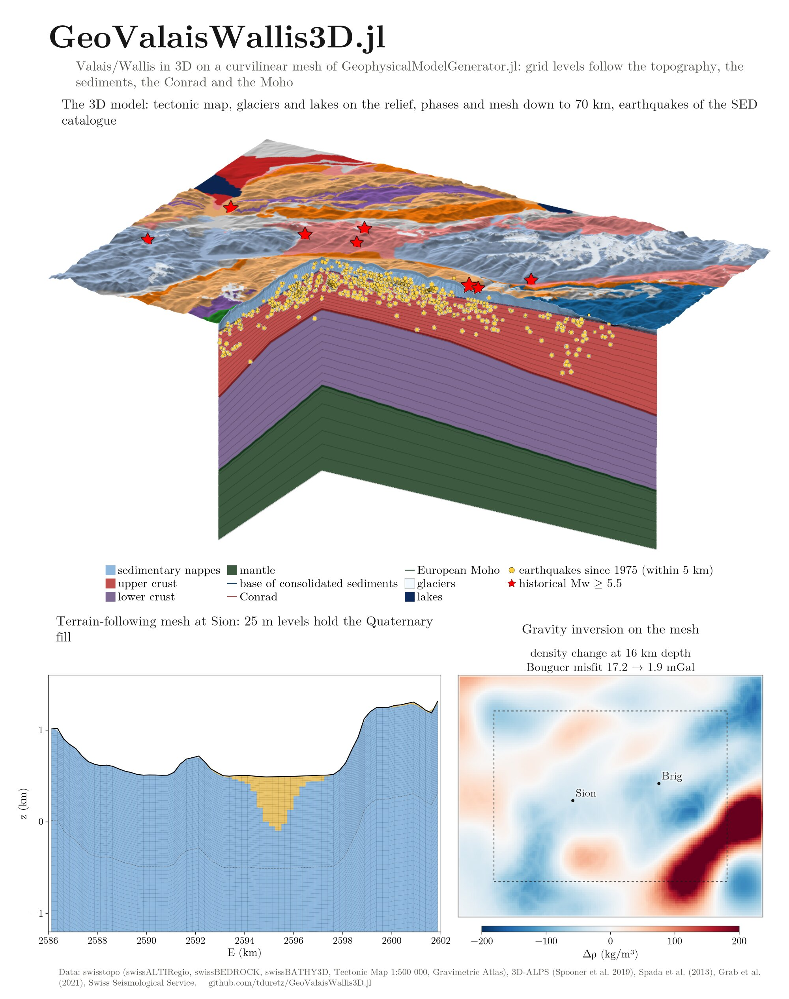

# The model on a curvilinear mesh

GeophysicalModelGenerator.jl 0.10.2 can build curvilinear meshes with `curvilinear_grid` and `deform_grid`. Their
horizontal grid levels follow surfaces, and `voxel_grav` computes the gravity of such a mesh. This folder redoes the
analysis of the package on such a mesh. The rectilinear grid ([`build_valais_model`](../../src/model.jl)) and its figures
are in [rectilinear/](../rectilinear/README.md).

## The mesh

`valais_curvilinear_maps` / `build_valais_curvilinear_model` ([src/curvilinear.jl](../../src/curvilinear.jl)) build a
mesh with 250 m columns. Its levels follow these surfaces, from top to bottom (`meshing_surfaces`):

| surface | data | level | cells in the layer below (spacing where thickest) |
|---|---|---|---|
| topography | swissALTIRegio | 288 | 40 (25 m) |
| base of the near-surface layer | 1 km below the topography (≥ 250 m, ≤ half-way to the next surface) | 248 | 73 (100 m) |
| base of the consolidated sediments | 3D-ALPS / swissBEDROCK | 175 | 77 (500 m) |
| Conrad | 3D-ALPS, scaled to the Spada Moho | 98 | 59 (500 m) |
| European Moho | Spada et al. (2013) | 39 | 38 (1 km) |
| bottom | −70 km | 1 | |

The mesh has 520 × 380 × 288 = 56.9 M nodes, and none of them lies in the air.

These are the interfaces that can be meshed: they span the whole region and never cross.

- **Exact grid levels:** the topography, the Conrad, the European Moho and the bottom are grid levels in every column.
- **Base of the consolidated sediments:** this is a grid level too, except in the 3.7 % of the columns where the
  sediments pinch out (crystalline massifs). There the mesh keeps a minimum layer thickness, and the grid level lies up
  to 323 m below the interface.
- **Not meshable:**
  - The base of the Quaternary is absent in 80 % of the columns. It lies inside the 25 m layer, whose base is 1 km
    deep, while the deposits are at most 1 km thick.
  - The Adriatic Moho is a wedge that crosses the Conrad.

  Both remain boundaries between materials. The material rules are the same as on the rectilinear grid (a shared
  `_model_point`), applied at every node.

Example: `julia --project=. -t auto examples/curvilinear/build_valais_model.jl`.

`spacing = :sbp` places the points of each layer at the nodes of a summation-by-parts grid, as used by SeismicWavePC.jl.

## Meshes for SeismicWavePC

SeismicWavePC (≥ 0.2.0) simulates waves on such meshes with summation-by-parts (SBP) finite differences, and has its own
requirements. `valais_curvilinear_maps` meets them with these options:

- **`columns = :sbp`.** The columns sit at the SBP nodes from edge to edge of the region (`sbp_nodes`). The rasters are
  read at `dx_data` and interpolated onto the columns.
- **`spacing = :sbp`.** The levels of each layer sit at SBP nodes.
- **`interface_above = true`.** A node on a meshed interface takes the material above it, the solver's convention.
- **`depths` and `interfaces`.**
  - *Why:* the solver splits the mesh into blocks only where the material jumps along the whole width. In the Valais
    only the Moho does that everywhere: the Adriatic wedge breaks the Conrad, and the crystalline outcrops break the base
    of the sediments. A change of vertical spacing at any other grid surface lowers the accuracy there.
  - *Choice:* a wave mesh therefore follows the topography, surfaces parallel to it (e.g. `depths = (1.0, 3.0)`), the
    Conrad and the Moho (`interfaces = (:conrad, :moho)`). The spacing then grows gradually from layer to layer.
- **`heights = false`.** The heights of the whole mesh are not stored. `curvilinear_heights(maps, ix, iy)` and
  `valais_model_block` compute them for the columns of one MPI rank.

The Rawil wave simulations ([ValaisRawilWaves](https://github.com/tduretz/ValaisRawilWaves), `scripts/curvilinear/`)
use these options. `interpolate_curvilinear` carries the density change of the gravity inversion over onto the wave
mesh.

## Figures

```bash
GVW_BACKEND=metal julia --project=figures -t auto figures/curvilinear/make_figures.jl          # all
julia --project=figures -t auto figures/curvilinear/make_figures.jl mesh layers sections        # some of: overview mesh layers sections subsoil gravity density glaciers seismicity morcles showcase
```

`overview` and `showcase` render their 3D panels with GLMakie, which needs a display. `gravity` and `density` call GMG
`voxel_grav` on curvilinear grids. Their results are cached in `data/output/curvilinear_*.jls`.

**Overview.** The fence diagram of the model, with the tectonic map on the relief. The cut faces show the phases, every
4th grid level, and the meshed surfaces.



**The mesh.** Section B–B' with every 4th level and column. The zoom on the Rhône valley at Sion shows every level and
column: the Quaternary fill (yellow) lies in the 25 m levels that follow the topography. On the right, the cell height
in the column at Sion.


**Meshed surfaces.** Maps of the levels of the mesh, with the Quaternary thickness and the Adriatic Moho, which is not
meshed. The red outline marks the columns where the level of the base of the consolidated sediments is pushed down.



**Sections.** Phases, Vs and temperature at the nodes of sections A–A' and B–B'. Each node is drawn as its dual cell,
so the colours follow the mesh exactly.


**Subsoil classes and the Quaternary on the mesh.** The CREALP / BAFU map, and N–S sections across the Rhône valley at
Martigny, Sion and Visp:
- Vs on every level of the mesh;
- the base of the Quaternary (white line);
- the surface class of the map at each section (squares).


**Gravity.** The attraction of the topography (sea level to the surface, 2670 kg/m³), computed by GMG `voxel_grav` on
two curvilinear layers whose top is the topography: 250 m columns out to 10 km, then 1 km columns out to 100 km.

| comparison | mean | std | range |
|---|---|---|---|
| GMG − the package's prisms and line masses, at 1 km stations | 2.3 mGal | 1.3 mGal | −1.9 to 6.1 mGal |

The GMG grids are flat, while the package accounts for the curvature of the Earth.


**Density inversion.** The Bouguer anomaly (8168 atlas points) is inverted on a curvilinear mesh:
- columns every 1 km, with 20 km of padding;
- levels that follow the same surfaces;
- 170 × 135 × 65 = 1.49 M unknowns, and no air nodes, hence no rock fractions.

The density of a node is the mean of the 250 m model over its dual cell, at depths below the local topography. The
reference is 2670 kg/m³ above sea level and the mean density per 500 m depth bin below it.

| inversion | unknowns | LSQR iterations | time on the Apple M2 Max GPU | rms misfit, start → final |
|---|---|---|---|---|
| curvilinear mesh (this folder) | 1.49 M | 66 | 158 s | 17.2 → 1.9 mGal |
| rectilinear grid ([rectilinear/density.jpg](../rectilinear/density.jpg)) | 1.0 M | 62 | 71 s | 18.1 → 1.9 mGal |

The starting misfit is lower here: the padding now holds the model (topography, 3D-ALPS, Moho) instead of uniform
densities. The Ivrea body again needs about +200 kg/m³.


**Glaciers and lakes.** `glaciers = true` and `lakes = true` (off by default) put glacier ice and lake water between the
topography and the glacier bed (Swiss Glacier Thickness R2020, Grab et al. 2021) or the lake floor (swissBATHY3D):
48.3 km³ of ice (up to 763 m, Aletsch) and 13.0 km³ of water (Lac Léman, up to 250 m) in the region. The top level of
the mesh stays the topography, so both lie in the 25 m layer.
- **Gravity:** at the atlas points they change gravity by −10 to +1 mGal: the stations are almost all in the valleys.
- **No gain in the misfit.** At the 102 stations where they lower gravity by more than 1 mGal, the starting model of the
  inversion is already 11 mGal lighter than observed. Either the atlas reduction already accounts for the ice and
  lakes, or the crystalline massifs under the glaciers are denser than in 3D-ALPS. The gravity figures therefore leave
  them off.



**Seismicity.** The SED catalogue (since 1975 by depth; historical events of Mw ≥ 4.5 as stars), the St-Léonard and
Anzère sequences north of Sion with the relocations and focal mechanisms of Truttmann et al. (2023), and the hypocentres
within 10 km of section A–A' on the model. Of the hypocentres since 1975, 64 % lie in the upper crust and 36 % in the
consolidated sediments; the bands at fixed depths (e.g. 1, 2, 10 km) are events whose depth the SED could not resolve.



**Morcles.** A W–E section of the Morcles model, sampled on a 2D curvilinear mesh: GMG `curvilinear_grid` with a single
`y`, 50 m columns and 25 m levels from the topography. Compared with the 50 m voxels, the mesh follows the relief
instead of making steps.


**Showcase.** One image for posts: the fence diagram, the mesh at Sion and the gravity inversion.


